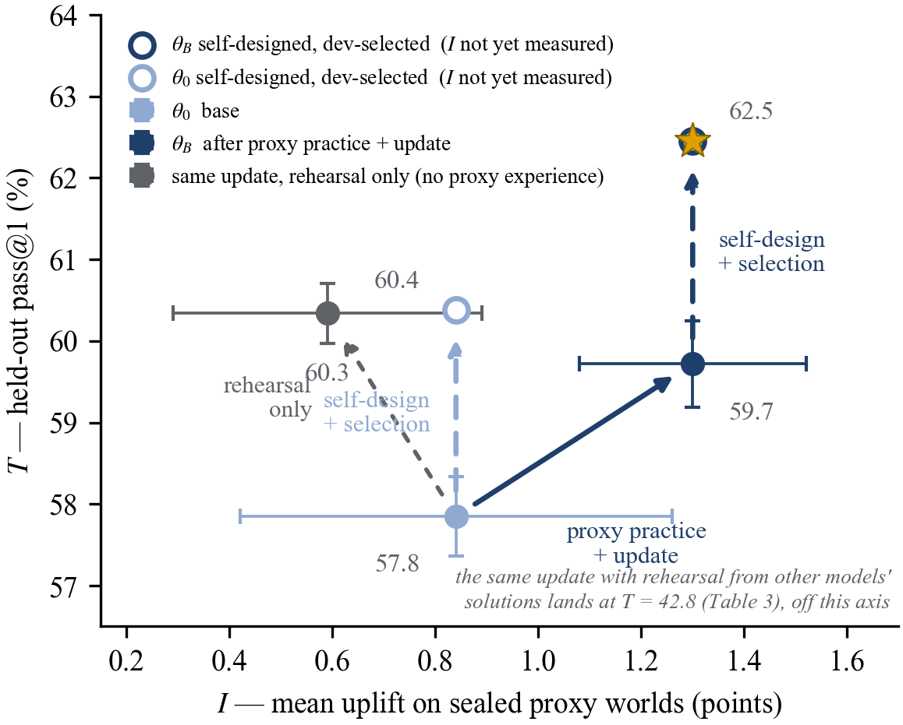

# Minimal-RSI

**Does practicing on a smaller model make a model better at improving itself?**

**Read the report:** https://haochen2115.github.io/minimal-rsi/ ([English](https://haochen2115.github.io/minimal-rsi/en/) · [中文](https://haochen2115.github.io/minimal-rsi/zh/))

A minimal recursive self-improvement loop in which every step is real: a 9B model (Qwen3.5-9B) designs training programs for flawed 2B models, the programs are executed and measured, the 9B is fine-tuned on the ones that worked, and it then designs — and undergoes — its own training. One model family, supervised fine-tuning only, eight 40 GB GPUs, two full turns.

Main results:

- One update raises both abilities at once: improvement ability on sealed proxy tasks +0.8 → +1.3 points of uplift, the 9B's own held-out pass@1 +1.9. A dose-matched control attributes the first to the improvement experience and the second to on-policy rehearsal.
- The updated 9B's self-designed training, selected on a development split, reaches 62.5% pass@1: +4.6 over the base model, +2.1 over the same procedure without proxy practice.
- Self-designed training mostly hurts (19 of 30 programs), but the good programs are predictable from a development split (r = 0.79): selection is worth more than learned design at this scale.
- Without an external input the loop turns once: the no-practice chain gains +2.5 and stops, while in the practice chain the ability fed by real experiments keeps rising and task ability plateaus. Self-improvement without new information is compression, not expansion.

This repository hosts the report only; the experiment code and run records are not released yet.

## 简介

**在更小的模型上练习，能让模型更擅长改进自己吗？**

**阅读报告：** https://haochen2115.github.io/minimal-rsi/zh/

一个最小的、每一步都真实执行的递归自我改进闭环：9B 模型（Qwen3.5-9B）为带缺陷的 2B 模型设计训练方案，方案被执行、效果被测量，9B 在有效的方案上微调，然后为自己设计训练并接受这次训练。单一模型家族、仅监督微调、8 张 40GB GPU、完整两圈。一次更新让改进能力与任务能力同时上升（I +0.8 → +1.3，T +1.9）；更新后的模型自我设计加开发集选择达到 62.5%（比基座 +4.6，比不经练习的同一流程 +2.1）；自我设计的训练多数有害但可由开发集预测；没有外部输入的闭环只转一圈——自我改进在没有新信息时是压缩，不是扩展。

本仓库只包含报告页面，实验代码与记录暂未公开。

---

Hao Chen · haochen2115@gmail.com
